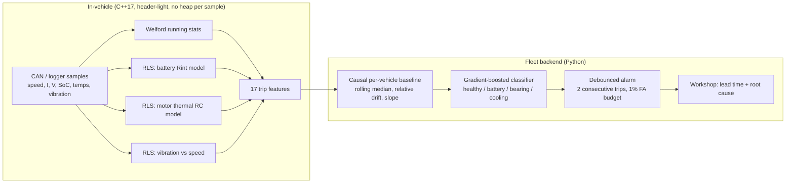
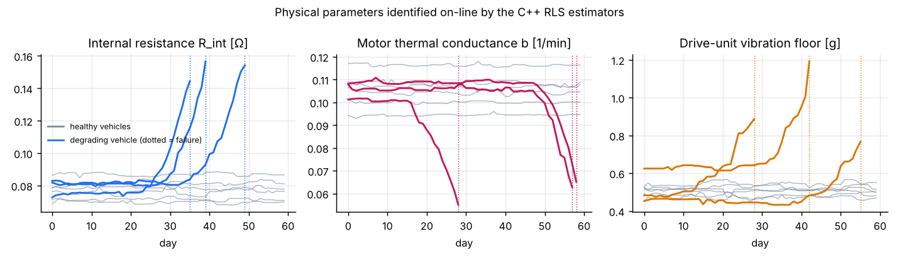
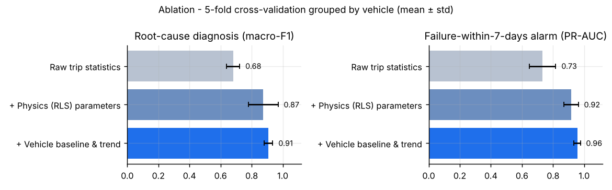
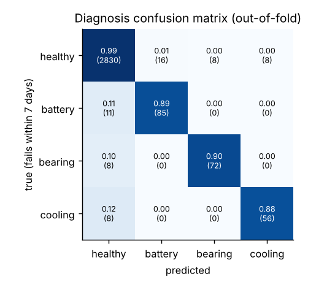
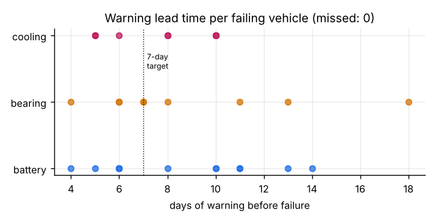

# CAR Diagnosis — VoltSense ⚡ Predictive Maintenance for EV Powertrains

[](../../actions/workflows/ci.yml)


**VoltSense predicts which EV component will fail in the next 7 days and which part it is (battery, drive-unit bearing or motor cooling), so a workshop can book the repair before the car breaks down.**

It combines an **embedded-style C++17 core** that identifies physical parameters on-line (as a BMS or motor ECU would) with a **Python ML pipeline** that turns them into fleet-level prognostics.

| Result (60-vehicle simulated fleet, 3,102 trips, vehicle-grouped 5-fold CV) | |
|---|---|
| Failing vehicles warned ≥ 1 day before failure | **30 / 30** |
| Median warning lead time | **8 days** |
| Root-cause diagnosis, macro-F1 | **0.91 ± 0.03** |
| 7-day failure alarm, PR-AUC | **0.96 ± 0.02** |
| Trip-level false-alarm budget on healthy cars | **1 %** |
| Healthy cars that ever got a (confirmed) false alarm | 3 / 30 |
| C++ feature extraction throughput | **~600k samples/s**, >30× the Python reference |

---

## Why this project

Automotive OEMs are moving from *fix it when it breaks* to *fix it before the customer notices*. That requires three things working together, and this project builds each of them:

1. **On-board signal processing that runs on an ECU budget.** Constant memory, O(1) per sample, no stored time series. Only 17 numbers per trip need to go to the cloud.
2. **Physics-informed features.** Engineers trust and can explain *"internal resistance rose 40%"*. They cannot do the same with a black-box score on raw voltage.
3. **Honest ML evaluation.** No data leakage between vehicles or through time, plus metrics that map to workshop decisions (lead time, false alarms per car).

## Architecture



### The physics models identified on-line (`cpp/include/voltsense/`)

| Component | Model | Estimated parameter | Degrades when… |
|---|---|---|---|
| HV battery | `V = OCV(SoC) − R_int · I` | internal resistance `R_int` | cells age / imbalance → `R_int` ↑ |
| Traction motor | `ΔT = a·I² − b·(T − T_coolant)` | thermal conductance `b` | coolant pump wears → `b` ↓ |
| Drive unit | `vib = v₀ + k·speed` | vibration floor `v₀` | bearing wear → `v₀` ↑ plus impulsive spikes |

Each model uses a **Recursive Least Squares** estimator with exponential forgetting (`rls.hpp`), a templated, allocation-free implementation suitable for a microcontroller. The figure below shows the estimators recovering the degradation from noisy telemetry, while healthy cars (grey) stay flat despite manufacturing spread:



## Results

### Ablation: every layer of the design pays for itself



| Feature set | Diagnosis macro-F1 | Alarm PR-AUC |
|---|---|---|
| Raw trip statistics (means, maxima, std) | 0.68 ± 0.04 | 0.73 ± 0.09 |
| + Physics parameters from C++ RLS | 0.87 ± 0.10 | 0.92 ± 0.05 |
| + Per-vehicle baseline & trend | **0.91 ± 0.03** | **0.96 ± 0.02** |

The physics features give the biggest jump. Normalising each car against *its own* early-life baseline then removes the vehicle-to-vehicle spread and makes the model much more stable across folds.

### Diagnosis and lead time

<p float="left">
  
  
</p>

The alarm threshold is set so that **at most 1% of trips from healthy cars** raise an alarm. Alarms need **2 consecutive trips** to confirm, like a DTC confirmation counter. An alarm that fires *before* the degradation physically starts counts as a false alarm, not as an early detection. That way a lucky guess can't inflate the lead time. All numbers are in [`docs/results.json`](docs/results.json) and are regenerated by the pipeline.

## Engineering rigour

- **Numerical parity tests:** the C++ extractor is checked against an independent, readable Python reference implementation (`rtol 1e-6`).
- **Leakage tests:** a unit test changes future data and asserts that past features don't change, which proves the pipeline is causal and could run on-line.
- **Vehicle-grouped, fault-stratified CV:** the model is always scored on cars it has never seen.
- **Physics unit tests in C++:** RLS must recover known `R_int`, `a`, `b` and vibration floor from synthetic data; Welford statistics are tested for numerical stability at a 1e6 offset.
- **Clean build** with `-Wall -Wextra -Wpedantic -Wconversion -Wshadow`, `ruff` linting, and GitHub Actions CI on every push.

## Quick start

```bash
# 1. Build and test the C++ core
cmake -S . -B build -DCMAKE_BUILD_TYPE=Release
cmake --build build -j
ctest --test-dir build --output-on-failure

# 2. Install the Python package and run the tests
pip install -e ".[dev]"
pytest

# 3. Full run: simulate fleet -> C++ features -> ML -> figures (~1-2 min)
python -m voltsense.pipeline
```

The C++ extractor also works on its own as a streaming CLI tool:

```bash
./build/voltsense_extract telemetry.csv features.csv     # or: cat telemetry.csv | ./build/voltsense_extract - -
```

## Repository layout

```
cpp/
  include/voltsense/   rolling_stats.hpp · rls.hpp · trip_features.hpp
  src/                 trip_features.cpp
  apps/                extract_features.cpp   (streaming CSV -> features CLI)
  tests/               test_core.cpp          (dependency-free, run by CTest)
python/voltsense/
  simulator.py         physics-based EV fleet + fault injection
  features.py          C++ bridge, Python reference, causal fleet features, labels
  model.py             gradient boosting, grouped CV, alarm policy, lead time
  pipeline.py          end-to-end run + figures
python/tests/          parity, leakage, physics and lead-time tests
.github/workflows/     CI: build, C++ tests, lint, Python tests, pipeline smoke run
```

## Limitations and next steps

The data is **simulated** (on purpose: real fleet failure data is proprietary). The simulator uses first-principles models with per-vehicle manufacturing spread, climate and driver style, but real vehicles add sensor dropouts, firmware changes and fault modes that overlap. To take this toward production I would:

- read real signals from **CAN / DBC** files (e.g. with `cantools`) and validate on a public dataset such as NASA's battery ageing data
- port the C++ core to a fixed-point, **MISRA-C++**-checked build for an AUTOSAR software component
- add **survival models** (time-to-failure distribution) and probability calibration
- add drift monitoring for over-the-air model updates

## Author

**Kaarthic Pranav Thirumurthy**: data science and AI for automotive systems. Open to roles in predictive maintenance, vehicle data analytics and ADAS data engineering.

Licensed under the [MIT License](LICENSE).
